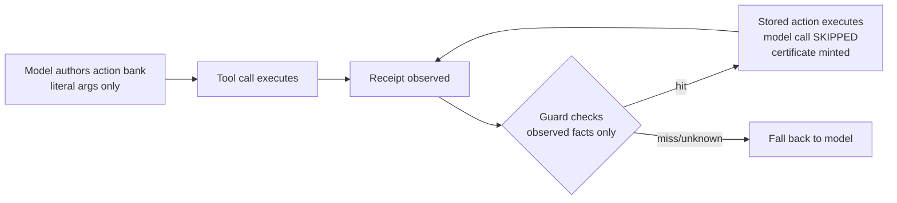

# GDR: Guarded Decision Reuse

An independent, runnable implementation of the decision-reuse mechanism from
[HarnessMM](https://arxiv.org/abs/2610.32813) (*Recursive Self-Improvement for
Harness Token Efficiency*, Jiang et al., THU + MSRA, 2026), with honest
measurements of where it wins and where it loses.

> The paper has no official code. This repo is, to our knowledge, the first
> independent implementation with published A/B data.

## What it is

An agent-harness pattern for **skipping model callbacks that are already
decided**:

Three properties make it safe to run:

1. **Literal closure** — every declared action's arguments must be concrete
   JSON at declaration time. No `${placeholder}` awaiting future feedback.
   Enforced at parse time, re-checked at admission.
2. **Observation-only guards** — guards consume *observed tool receipts*
   (`last_ok`, `file_exists:<path>`), never model predictions. An unknown
   guard defers to the model. Failure is bounded: one wasted fallback call.
3. **Certificates** — every skipped model call mints a numbered certificate
   binding the executed literal action to the omitted call. The ledger is
   append-only and machine-checkable. No silent substitution.

## What the measurements actually say

Two A/B rounds on a private Rust harness (sigil), 4 mini coding tasks
(write module + run test + report), Qwen3.8-27B on local hardware:

| Round | Arm | Success | Model calls | Total tokens | Certified substitutions |
|---|---|---|---|---|---|
| 1 | off | 4/4 | 19 | 25.5k | 0 |
| 1 | tool-authored | 4/4 | 15 (**-21%**) | 28.1k (**+10%**) | 4 |
| 2 | off | 4/4 | 21 | 136.3k | 0 |
| 2 | tool-authored | 4/4 | 11 (**-48%**) | 75.5k (**-45%**) | 5 |
| 2 | inline-authored | 4/4 | 12 | 80.0k (-41%) | 0 |

Three findings, none of which the paper's headline (87.93% savings) conveys:

- **Round 1 reproduces the substitution paradox** (paper App. D.8): the token
  cost of *authoring* declarations exceeded the callbacks saved. On short
  tasks the mechanism loses money.
- **Round 2's -45% is mostly a behavioral effect, not the mechanism.** Only 5
  substitutions occurred; the bulk of the savings came from the authoring
  instruction changing how the model planned ("decide fully, then act"),
  which halved exploratory tool calls (21 → 11). This mirrors the paper's own
  clean ablation (GDR alone: 26.91%, one CI including zero) versus its
  headline number (a stack of mechanism + context compression + tuning).
- **Inline authoring (a fenced block in assistant text) conflicts with
  streaming tool calls** — 0 substitutions across 4 tasks. Reliable inline
  declaration needs a structured side-channel, not free text.

**Practical guidance:** the authoring *instruction* (a prompt line) is worth
adopting everywhere; the mechanism pays off only on workloads with many
repeated callbacks (long review-fix loops, benchmark rounds); keep it off for
short tasks.

## Repository layout

- `docs/PROTOCOL.md` — the harness-neutral wire protocol (node schema, guard
  vocabulary, certificate format). Integrate against this.
- `gdr-core/` — dependency-free Rust crate: bank, guards, closure validation,
  certificate ledger, inline parser. 12 unit tests.
- `docs/INTEGRATION.md` — how to wire GDR into your own agent loop (the
  controller hook point, transcript invariants).
- `docs/EVAL.md` — full experiment methodology and raw data.

## Status

Working reference implementation + measurements. Not a library you can pip
install yet; the crate is extracted verbatim from the sigil harness and may
still reference harness types. v0.2 will make it standalone.

## License

MIT
